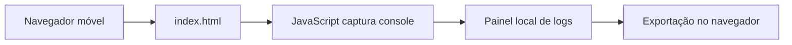

 |  | 

# Mobile Console Viewer — Fork de Ferramenta de Depuração

> Este repositório é um fork de [Programming-Newbies-Community/Mobile-Console-Viewer](https://github.com/Programming-Newbies-Community/Mobile-Console-Viewer). Verifique a licença e os créditos upstream antes de redistribuir.

## Visão geral

Uma página web estática de demonstração de console para depuração no navegador: o JavaScript substitui console.log, console.error, console.warn e console.info para registrar e exibir mensagens no painel da própria página, com timestamp, contagem, limpeza e exportação. Isso descreve o código; o README atual fala principalmente de soberania tecnológica e não explica esse propósito técnico.

## Objetivo e valor

**Problema/escopo:** Console JavaScript em página web responsiva para visualizar logs no navegador, com painel móvel, timestamps, limpeza e exportação.

**Valor verificável hoje:** o repositório torna explícitos seus artefatos, interfaces e limitações para que mantenedores e contribuidores possam avaliar o que existe sem confundir demonstração, proposta e produção.

## Arquitetura e tecnologias

O README não documenta arquitetura. A árvore e index.html mostram uma página de entrada HTML que carrega css/style.css e js/console-viewer.js; o JavaScript manipula DOM e APIs do navegador, sem backend ou módulo de build visível. A árvore pública não contém .github/workflows nem outros workflows; não há manifesto de dependências listado.

- JavaScript (GitHub reporta 13.294 bytes)
- CSS (7.582 bytes)
- HTML (2.508 bytes)
- Implementação estática no navegador, sem framework ou ferramenta de build evidenciada nos arquivos examinados; nenhum package.json ou outro manifesto de dependências na árvore.

## Início rápido

Os comandos abaixo refletem instruções, manifestos ou pontos de entrada presentes no repositório. Dependências externas, segredos e serviços estão indicados quando aplicável; a presença de um comando não equivale a uma execução validada.

1. Nenhum comando de instalação, servidor ou execução é fornecido pelo README nem comprovado por manifesto ou workflow. A árvore contém index.html e assets locais, mas o uso via navegador não há execução validada registrada.

## Exemplo de uso

Uso possível pelas interfaces presentes: abrir index.html em um navegador e clicar no botão de log comum (“普通日志”); o evento está ligado à função que chama console.log, interceptado pelo script e adicionado ao painel de logs. Isto é inferido da correspondência entre HTML e JavaScript, não resultado de execução testada.

## Estado e limitações

**Maturidade indicada:** Fork e demonstração.

- A descrição e o README sobre soberania nacional, IA e blockchain não são sustentados pelos arquivos de implementação examinados; a funcionalidade verificável é uma página local que captura quatro métodos de console.
- O HTML apresenta funcionalidades informativas como suporte a arrays/objetos e exportação; não foram testadas em runtime.
- O JavaScript tenta ligar controles e elementos de filtro por IDs/classes (filterBtn, filterMenu e botões .filter-menu), mas eles não aparecem no index.html consultado; não documentar filtragem como interface funcional sem validação/correção.
- O projeto é um fork, e o repositório pai descreve o projeto como ferramenta de logs/depuração mobile; não atribuir a origem original ao fork sem distinguir os créditos visíveis.

## Contribuição

Leia [CONTRIBUTING.md](CONTRIBUTING.md) antes de abrir uma issue ou pull request. Para reportes de segurança, siga a orientação específica do repositório, se houver.

## Licença

Este repositório é um fork e o licenciamento herdado requer revisão: mantenho o arquivo de licença recebido sem declarar permissão sobre material de terceiros. Consulte a origem antes de reutilizar.

## Patrocínio e apoio

O desenvolvimento aberto exige tempo para manutenção, documentação, testes, revisão de contribuições e resposta a issues. Se este projeto for útil, considere apoiar a continuidade pelo [GitHub Sponsors](https://github.com/sponsors/felipetjmg1-bit). O apoio não representa promessa de funcionalidades, prazo de entrega ou suporte comercial.

